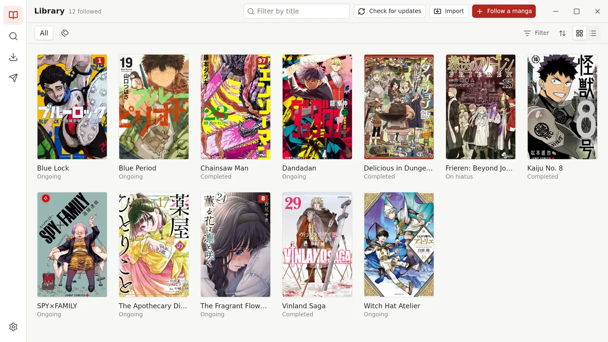
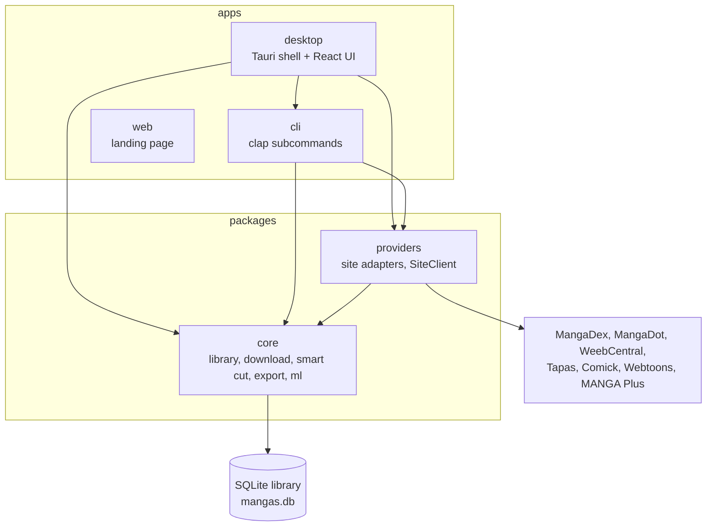

# Mangas

<p align="center">
  
</p>

<p align="center">
  <strong>Follow manga and webtoons, download new chapters, and read them on your Kindle</strong>
</p>

<p align="center">
  <a href="#features">Features</a> •
  <a href="#quick-start">Quick start</a> •
  <a href="#usage">Usage</a> •
  <a href="#architecture">Architecture</a> •
  <a href="#development">Development</a> •
  <a href="#status">Status</a> •
  <a href="#contributing">Contributing</a>
</p>

<p align="center">
  <a href="https://github.com/kerbaras/mangas/actions/workflows/ci.yml"></a>
  <a href="https://github.com/kerbaras/mangas/releases/latest"></a>
  <a href="LICENSE"></a>
  
</p>

<p align="center">
  <picture>
    <source media="(prefers-color-scheme: dark)" srcset="apps/web/src/assets/library-dark-1280.webp"/>
    
  </picture>
</p>

Mangas is a desktop manga/manhwa library and Kindle exporter. Follow series from MangaDex,
MangaDot, WeebCentral, Tapas, Comick, Webtoons and MANGA Plus, download chapters, and turn them into
fixed-layout EPUBs sized for a Kindle. Long webtoon strips are cut into pages at gutters instead
of at fixed heights, so panels, speech bubbles and faces stay whole.

Rust core, Tauri 2 + React desktop app, and a small CLI that exposes the same operations.
Website and downloads: https://kerbaras.github.io/mangas

---

## Features

- **Seven sources.** MangaDex, MangaDot, WeebCentral, Tapas, Comick, Webtoons and MANGA Plus
  behind one search. Comick sits behind a browser check, so connect it once in
  Settings → Downloads → Sources.
- **A library that keeps up.** Follow titles, check them for new chapters, and download through a
  queue that the app and the CLI share and that picks up where it left off after a restart.
- **Smart cut for webtoons.** Long strips split at the gaps between panels, with an optional
  speech-bubble and face detector. Preview the pages before you export.
- **EPUB, CBZ or PDF.** Single chapters or whole volumes, sized for Kindle, Kobo, reMarkable or a
  tablet (`mangas kindle --list-profiles`).
- **Send to Kindle.** Email the book to your Kindle address or copy it over USB.
- **One executable.** The `mangas` binary opens the app with no arguments and runs the CLI with
  them.

## Quick start

### Install

Builds for macOS (arm64, Intel), Windows (x64, arm64) and Linux (x64, arm64) are on the
[releases page](https://github.com/kerbaras/mangas/releases). Release candidates are marked
pre-release. Take the file for your system from the
[latest release](https://github.com/kerbaras/mangas/releases/latest):

| System | File |
|---|---|
| macOS, Apple silicon | `Mangas_<version>_aarch64.dmg` |
| macOS, Intel | `Mangas_<version>_x64.dmg` |
| Windows x64 / arm64 | `Mangas_<version>_x64-setup.exe` / `Mangas_<version>_arm64-setup.exe` |
| Debian, Ubuntu | `Mangas_<version>_amd64.deb` / `Mangas_<version>_arm64.deb` |
| Fedora, openSUSE | `Mangas-<version>-1.x86_64.rpm` / `Mangas-<version>-1.aarch64.rpm` |
| Any Linux | `Mangas_<version>_amd64.AppImage` / `Mangas_<version>_aarch64.AppImage` |

On Linux:

```bash
sudo apt install ./Mangas_<version>_amd64.deb      # puts mangas on your PATH
chmod +x Mangas_<version>_amd64.AppImage && ./Mangas_<version>_amd64.AppImage
```

The Linux builds need glibc 2.35 or newer (Ubuntu 22.04, Debian 12, Fedora 37 or later).

**macOS.** The bundle is ad-hoc signed unless the repository has an Apple Developer ID. Open the
app once, then go to System Settings → Privacy & Security and click Open Anyway (right-click →
Open no longer works on macOS 15).

### First run

Open Mangas, search for a title and follow it. Or do the same from a terminal:

```bash
mangas search "solo leveling"
mangas add <manga-id>
mangas download <manga-id> --chapters 1-5
```

Data lives in the platform data directory (`~/.local/share/mangas` on Linux): `mangas.db`,
`chapters/`, `models/`.

## Usage

### CLI

The CLI and the desktop app share the library, the download queue and the settings.
`mangas --help` lists every command.

```bash
# Find and follow
mangas search "solo leveling"
mangas add <manga-id>
mangas chapters <manga-id>
mangas settings languages es-la,en  # preferred chapter languages, shared with the app
mangas providers options mangadex --set data_saver=true --set preferred_groups="A,B"

# Keep up and download
mangas update                       # check followed titles for new chapters
mangas download <manga-id> --chapters 1-5
mangas queue ls

# Export
mangas kindle ~/.local/share/mangas/chapters/<manga>/<chapter>... -o out.epub \
    --profile kindle-paperwhite12 --cut-preset balanced
mangas kindle <chapter>... --format cbz --profile kobo-clara   # or pdf; -o book.pdf also picks pdf
mangas kindle --list-profiles
mangas export <manga-id> --by-volume --format cbz --profile kobo-clara   # one book per volume

# Detectors
mangas ml download                  # ONNX Runtime + models, about 190 MB
mangas kindle <chapter>... --detectors -o out.epub
mangas kindle <chapter>... --detectors --strict-detectors -o out.epub   # exit 1 if they can't run
```

`add`, `chapters` and `download` default `--lang` to the preferred languages (English when none
are saved) and sync every one of them; `download` takes each chapter in the first preferred
language that has it. `--lang es,en` overrides the list for one command.

### Smart cut

A long strip is split with a row-level cut cost (gutters, panel edges, text blocks, bubbles) and a
dynamic-programming paginator that picks the cheapest cut rows for the target page height. When a
cut has to go through art it can repeat a few rows on the next page (overlap) or shrink the page a
little so a whole panel fits. Presets:

| preset | max shrink | behaviour |
|---|---|---|
| `balanced` (default) | 10% | few shrunk pages, cuts at gutters |
| `fewest-cuts` | 25% | fewer cuts through art, smaller text |
| `no-shrink` | 0% | native size, overlap only |

`--detectors` adds ONNX speech-bubble/text and anime-face detectors to the cut cost. The ONNX
Runtime library and the models are downloaded on first use (or with `mangas ml download`) into
`models/` and verified by SHA-256. Execution uses CoreML on Apple silicon, CUDA with the opt-in
`cuda` feature, and the CPU everywhere else (Windows included). Every release has detector
support; a build from source needs the `ml` cargo feature. When the detectors can't run (no
runtime, or it won't load), `kindle` and `export` warn and cut without them, exiting 0;
`--strict-detectors` turns that into exit 1 with the runtime's error, before anything is written.

## Architecture



### Key components

| Path | Crate / package | What it does |
|---|---|---|
| `packages/core` | `mangas-core` | the `Source` contract, SQLite library, downloads, smart cut, Kindle filters, EPUB writer, optional ONNX detectors |
| `packages/providers` | `mangas-providers` | site adapters (MangaDex, MangaDot, WeebCentral, Tapas, Comick, Webtoons, MANGA Plus) on a shared rate-limited client, provider registry, browser-session support for Cloudflare-protected sites |
| `apps/cli` | `mangas-cli` | the command line as a library (+ a dev binary): `search`, `add`, `remove`, `chapters`, `download`, `list`, `kindle`, `export` and more (`mangas --help`) |
| `apps/desktop` | `@mangas/desktop` | Tauri shell (`src-tauri`, IPC only) and the React UI (`src`); builds the shipped `mangas` executable, which runs the CLI when given arguments and opens the app otherwise |
| `apps/web` | `@mangas/web` | the landing page (Astro + Tailwind, static), deployed to GitHub Pages by `.github/workflows/pages.yml` |

Business logic lives in `mangas-core`; the Tauri commands and CLI subcommands only parse input,
call core and format output. Design notes and decisions:
[`docs/rewrite-design.md`](docs/rewrite-design.md).

## Development

### Prerequisites

- Rust 1.89+
- Node 24 and pnpm 12
- For the desktop app, the [Tauri 2 system packages](https://v2.tauri.app/start/prerequisites/)
  (on Ubuntu: `pkgconf libgtk-3-dev librsvg2-dev libayatana-appindicator3-dev libwebkit2gtk-4.1-dev`)

### Build and run

```bash
cargo build --workspace            # core + CLI (+ desktop backend when the system libs are present)
pnpm install
pnpm -C apps/desktop dev           # desktop app with hot reload
pnpm -C apps/desktop dev:web       # UI alone in a browser, against an in-memory mock backend
cargo run -p mangas-cli -- --help  # the CLI from source
```

### Checks

All four must pass before a PR merges; CI runs the same commands.

```bash
cargo fmt --all -- --check
cargo clippy --workspace --all-targets -- -D warnings
cargo test --workspace
pnpm check      # biome + tsc + vitest + vite build
```

### Signed macOS builds

To ship signed and notarized macOS builds, add these repository secrets and the release workflow
picks them up: `APPLE_CERTIFICATE` (base64 `.p12`), `APPLE_CERTIFICATE_PASSWORD`,
`APPLE_SIGNING_IDENTITY`, `APPLE_ID`, `APPLE_PASSWORD` (app-specific password), `APPLE_TEAM_ID`.

## Project structure

```
mangas/
├── packages/
│   ├── core/            # mangas-core: domain, library, download, export, send, smartcut, ml
│   └── providers/       # mangas-providers: one module per site + shared http client
├── apps/
│   ├── cli/             # mangas-cli: one file per subcommand
│   ├── desktop/
│   │   ├── src/         # React UI
│   │   └── src-tauri/   # Tauri shell, IPC commands only
│   └── web/             # landing page (Astro)
├── docs/                # design notes
└── .github/workflows/   # CI, release, Pages, live smoke
```

## Contributing

Issues and pull requests are welcome. Rules for contributors and agents are in
[`AGENTS.md`](AGENTS.md): files under 200 lines, pure functions with IO at the edges, no
`unwrap()` outside tests, thin Tauri and CLI layers. Adding a site? See "How to add a provider" in
[`docs/rewrite-design.md`](docs/rewrite-design.md).

### Development workflow

1. Pick or open an issue; the roadmap and process live in the pinned
   [roadmap issue](https://github.com/kerbaras/mangas/issues/45)
2. Create a branch from `main`
3. Make the change with tests, and run the [checks](#checks)
4. Open a pull request with a conventional-commit title (`feat(providers): ...`, `fix(cli): ...`;
   CI checks it) and `Closes #<issue>` in the body

## Documentation

- [Website and downloads](https://kerbaras.github.io/mangas)
- [Changelog](CHANGELOG.md)
- [Design notes and decisions](docs/rewrite-design.md)
- [Contributor and agent rules](AGENTS.md)

## Security

- Downloaded models and the ONNX Runtime library are checked against pinned SHA-256 hashes
- Page downloads refuse private and local network addresses. Through a proxy, the proxy looks
  up image hosts, so only private IP addresses and `localhost` written in a link are refused
- The webview opens folders only inside the app's data folders or a folder you exported to

To report a vulnerability, please don't post the details in a public issue. Open an issue asking
for a private contact and the maintainer will follow up.

## License

This project is licensed under the MIT License. See the [LICENSE](LICENSE) file for details.

## Acknowledgments

- [HaruNeko](https://github.com/manga-download/haruneko), the reference for provider design
  (`mangas backup import` also reads its bookmarks export)
- The scanlation groups and sites that make the chapters available

## Status

Mangas is pre-1.0. Each minor version closes a
[milestone](https://github.com/kerbaras/mangas/milestones):

| Milestone | Status | Scope |
|---|---|---|
| v0.1.0, foundation | shipped | provider harness, contract tests, MangaDex, local import, diagnostics |
| v0.2.0, providers | shipped | Webtoons, Comick, Tapas, WeebCentral, multi-provider search |
| v0.3.0, download manager and library | shipped | persistent queue, new-chapter checks, library organisation, storage and backup |
| v0.4.0, export and Kindle | release candidate | volumes with TOC, CBZ/PDF, e-reader profiles, Send to Kindle, smart-cut preview |
| v0.5.0, desktop polish and distribution | in progress | auto-updater, onboarding, settings, performance, accessibility, theming |
| v1.0.0, release | planned | cross-platform QA, provider authoring guide, hardening |

## Support

- Issues: [GitHub Issues](https://github.com/kerbaras/mangas/issues)
- Website: [kerbaras.github.io/mangas](https://kerbaras.github.io/mangas)
